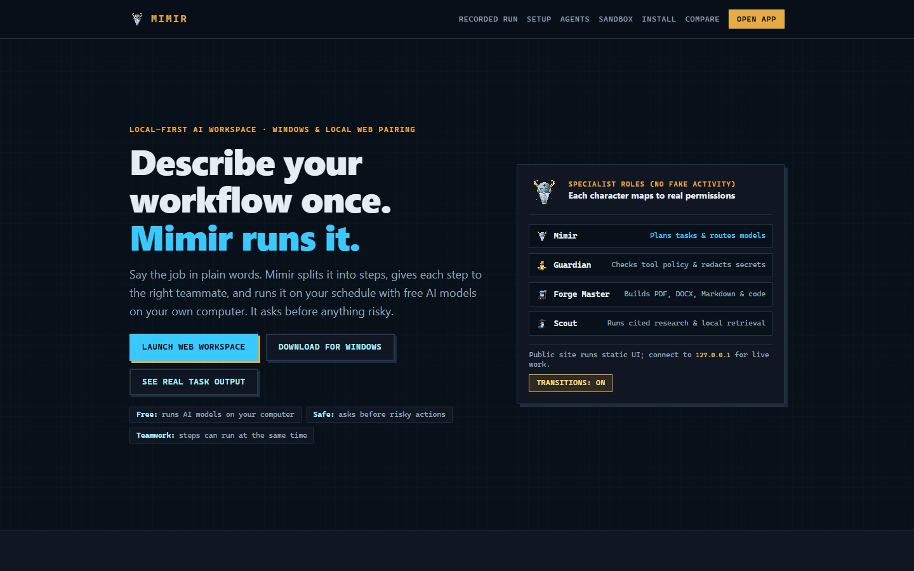
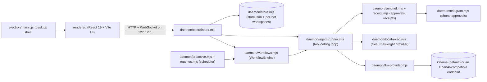

# Mimir

[](https://github.com/vaibhav4046/mimir/actions/workflows/ci.yml)

**Describe your workflow once, Mimir automates it. Free and local.**

You write a job in plain words, such as *"Every day at 8am, research competitor pricing, then write a short brief"*. Mimir turns it into a trigger and ordered steps, gives each step to a suitable assistant, and runs it on schedule with local models through [Ollama](https://ollama.com). No API key is needed. Anything irreversible stops at an approval gate first, which you can answer from the desktop app or your phone.



**Live site:** https://mimir-site-dusky.vercel.app (product page and Windows download; the app itself runs on your computer).

### What this demonstrates

- **Plain-English to durable workflow.** `daemon/workflows.mjs` parses a description into a trigger (daily, weekly, interval, file-watch or manual) and steps, routes each step to a bot by role, runs `parallel` steps in waves, checkpoints after every step and resumes a failed run from the step that failed. Covered by `tests/workflows.test.mjs`.
- **A tool-calling agent loop built for small local models.** `daemon/agent-runner.mjs` and `daemon/llm-provider.mjs` run tool calls against Ollama or any OpenAI-compatible endpoint, curate the tool list per role so a 1.7B model is not flooded, and fit history to the context window. `tests/tool-gate-bench.mjs` measures whether a small model over-calls tools (results below).
- **Human-in-the-loop safety.** Tools are classified by reversibility (`daemon/local-exec.mjs`). Outbound, system and credential actions go through `daemon/sentinel.mjs` for approval and leave receipts (`daemon/receipt.mjs`). `daemon/telegram.mjs` lets you approve from a phone, with a second confirm tap for irreversible actions (`tests/telegram.test.mjs`).

---

## Architecture



The daemon also hosts optional engines that are not on the main path: multi-model council (`model-council.mjs`), local RAG (`rag-engine.mjs`), deep research (`deep-research.mjs`), document generation (`foundry.mjs` with Python workers in `scripts/`), MCP servers (`mcp-manager.mjs`) and an opt-in tool-selection graph (`context-graph.mjs`, see `contextgraph/`). An optional Rust core lives in `rust/`.

---

## Core Capabilities

### 1. Live Canvas & Workspace Workbench
Open code, HTML, SVG, or Markdown files from chat code blocks (`Open in Canvas`), generated artifacts, or the workspace File Tree:
- **Edit & Save**: Edit directly inside `CanvasPane` and save changes back to the assistant workspace (`PUT /v1/workspace/:botId/file`).
- **Inline AI Revisions**: Enter an instruction in `"Ask Mimir to revise"` (`POST /v1/canvas/edit`), inspect the proposed update banner, and click **Apply** or **Undo**.
- **Sandboxed Live Preview**: Switch between `Code` and `Preview` to render HTML, SVG, or Markdown inside a sandboxed `<iframe sandbox="allow-scripts">` without leaving the workspace.

### 2. Browser & Computer Control
Drive an observable browser inside the **Work View -> Screen** tab (`daemon/local-exec.mjs` via Playwright):
- **Navigation & Inspection**: Address bar, Back/Forward/Reload controls (`POST /v1/computer/:botId/action`), screenshot enlargement, and a **Show element targets** overlay showing detected clickable elements.
- **Take Control Mode**: Toggle Take Control to click, drag, scroll, and send keyboard events directly into the focused browser viewport, or pause safely for manual 2FA/login handoff.
- **Runs Ledger & Memory**: Review autonomous runs (`approve` / `deny` / `cancel`), inspect persistent workspace layout and skill files, and search or edit assistant memories (`PATCH /v1/bots/:botId/memories/:key`) with scope and provenance metadata.

### 3. Multi-Agent Swarm & Boardroom
- **Team Topology**: Deploy a 6-assistant team (Chief of Staff plus domain specialists for research, copy, design, ops, and finance) with shared channels and `@mention` delegation (`dag-swarm.mjs`, `norse-agents.mjs`).
- **Model Council Boardroom**: Run prompts across multiple models in parallel, rank outputs blindly, and synthesize a consensus response (`model-council.mjs`).
- **Spaces & Branching**: Organize threads by Space with scoped instructions, switch the active assistant mid-thread, fork conversations, or edit an earlier prompt to branch cleanly.

### 4. Offline & Live Deep Research
- Switch explicitly between **Auto**, **Live Web**, and **Offline Corpus** modes from the chat composer.
- Ground answers against local workspace knowledge (`rag-engine.mjs`, `knowledge-rsi.mjs`) or live search (`deep-research.mjs`), displaying step-by-step progress and clearly distinguishing offline corpus results from live web citations.

### 5. Live Voice
- Hands-free voice modal (`VoiceLiveModal`) with turn-taking phases (`Standby`, `Listening`, `Thinking`, `Speaking`), drag-and-drop file staging, toggleable live transcript, and keyboard/text fallback whenever microphone capture or the local daemon is unavailable.

### 6. Sentinel Approvals, Vault & Receipts
- **Reversibility Gating**: Local reads, drafts, and workspace file operations run directly, while outbound actions, system commands, and credential access route through Sentinel approval gates (`sentinel.mjs`).
- **Receipts & Kill Switch**: Actions emit auditable receipts (`receipt.mjs`), credentials stay in the local vault (`vault.mjs`), and a global kill switch halts active runs.

### 7. Multi-Format Library & Forge
- Generate and preview documents, spreadsheets, slides, SVG illustrations, and media via `foundry.mjs` (`scripts/foundry_builder.py`, `scripts/creative_studio_builder.py`), and onboard new specialized assistants in **Forge** by importing notes or answering a 4-step setup guide.

---

## Requirements

- **Node.js 22+** (CI uses 22).
- **[Ollama](https://ollama.com/download)** for local models, with a model pulled (for example `ollama pull qwen3:1.7b`). 8 GB RAM is the practical minimum; a GPU with 4 GB+ VRAM helps.
- **Windows 10/11 x64** is the main tested desktop target (`npm run dist:win`). macOS and Linux run from source.
- **Optional Python 3.11+** for local voice (`scripts/voice_engine.py`) and binary document generation:
  ```bash
  python -m pip install -r scripts/requirements.txt
  ```

**What needs what:** no API key is needed for anything. Without Ollama the app, the UI, workflows editing and the test suite still run, but chat turns report that no model is reachable. An OpenAI-compatible or OpenRouter key is optional and only used if you add one in Settings.

---

## Quickstart

```bash
git clone https://github.com/vaibhav4046/mimir.git
cd mimir
npm ci
```

Run the coordinator daemon and the UI in two terminals. The UI looks for the daemon on port 4567, so pin it there (the daemon picks a random port otherwise):

```bash
# Terminal 1: coordinator daemon on 127.0.0.1:4567
MIMIR_PORT=4567 npm run dev:daemon        # PowerShell: $env:MIMIR_PORT=4567; npm run dev:daemon

# Terminal 2: Vite dev server, then open http://localhost:5173
npm run dev:renderer
```

Or run the Electron desktop shell, which starts its own daemon:

```bash
npm run build
npm start
```

Package the Windows installer with `npm run dist:win` (unsigned unless you provide a certificate, see [docs/RELEASING.md](docs/RELEASING.md)).

---

## Tests

```bash
npm test          # unit + integration suite (node:test), what CI runs
npm run build     # production renderer build, also run in CI
cargo build --release -p mimir-daemon --manifest-path rust/Cargo.toml   # optional Rust core (not built in CI)
```

`npm test` starts real coordinators on loopback ports, drives a headless Chromium through Playwright for the browser tests, and fakes model endpoints with local mock servers. One test needs a live Ollama with `qwen3:1.7b`; it skips itself when `CI` is set. The durable-queue test drives the Rust sidecar and skips unless you have built it with `cargo build --release -p mimir-daemon --manifest-path rust/Cargo.toml`; CI does not build it yet. CI is [.github/workflows/ci.yml](.github/workflows/ci.yml).

These need a local model, so they are not in CI:

```bash
npm run test:e2e  # full UI journey against the built renderer (needs Chromium)
npm run eval      # 8-task local model eval (needs Ollama)
node tests/tool-gate-bench.mjs qwen3:1.7b   # tool over-calling benchmark (needs Ollama)
```

---

## Results

From `node tests/tool-gate-bench.mjs qwen3:1.7b`, committed at [docs/tool-gate-bench.json](docs/tool-gate-bench.json). One run, 32 hand-written prompts (some need no tool, some need a specific one), real Mimir tool schemas, `qwen3:1.7b` on Ollama. Small sample, so treat the differences as indicative.

| Variant | Unneeded tool calls | Correct first tool | Overall OK | Avg tools offered | Avg prompt tokens |
|---|---|---|---|---|---|
| curated (what Mimir ships) | 6.3% | 50% | 71.9% | 8.4 | 896 |
| gate (no tools when the request shows no need) | 0% | 50% | 75% | 4.4 | 490 |
| graph (Context Graph narrows the list) | 0% | 62.5% | 81.3% | 5.9 | 664 |

Other measured runs (local eval suite, release checks) are kept as dated working notes in [docs/reports/](docs/reports/) and [docs/EVAL_REPORT.md](docs/EVAL_REPORT.md); they were recorded on one machine and need Ollama to reproduce.

---

## Honest Limits

- **Local machine uptime**: Scheduled routines and background runs execute while your computer is awake and the daemon is running; missed schedules catch up on wake.
- **Small local models**: 1B to 4B parameter local models run quickly offline, but multi-step coding, complex tool calling, and deep synthesis benefit from larger local models (7B+) or a configured external provider key.
- **Optional Python extras**: Voice synthesis/transcription and binary Office/PDF generation depend on the packages in `scripts/requirements.txt`; text, code, Canvas, chat, and browser features work without Python.
- **Unsigned desktop installer**: Packaged Windows builds from `electron-builder` are unsigned unless you provide your own code-signing certificate.

---

## License

MIT. See [LICENSE](LICENSE).
