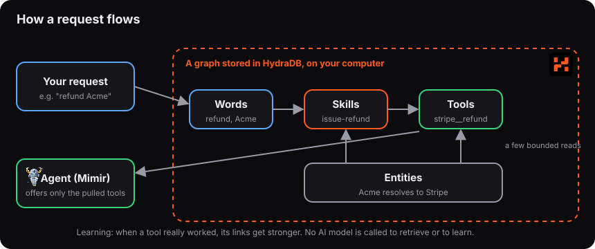
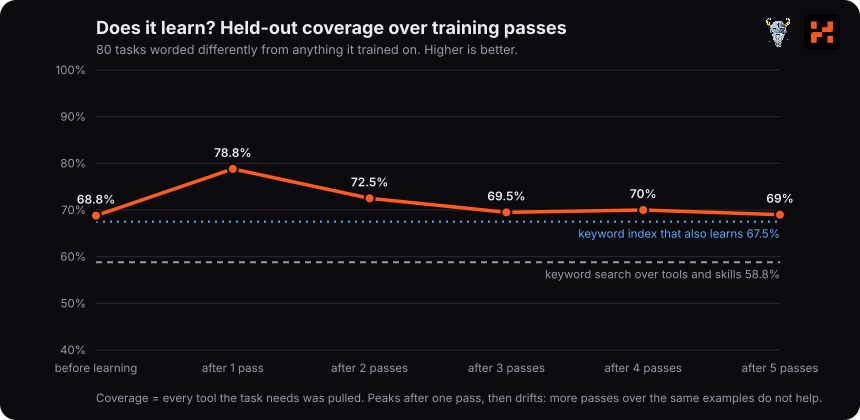
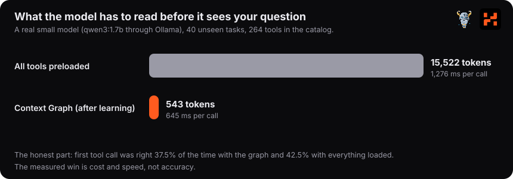

# Context Graph: an agent context layer on HydraDB

**Your agent shouldn't read 264 tool manuals before it reads your request.**
Context Graph keeps an agent's tools, skills and the things it has already resolved in a [HydraDB](https://github.com/hydra-db/hydradb) graph.
For each task the agent walks the graph and pulls only the few tools the task needs, and it adjusts its links when it is told what worked.

## In one minute (no technical background needed)

Imagine a helper who, before every single question, reads the instruction manual of every tool in a huge toolbox. That is how most AI agents work today. It is slow, it costs money, and small AI models that run on your own laptop cannot even fit all the manuals in their head.

**Context Graph is a map of the toolbox.** It remembers which tools belong to which jobs, hands the helper only the few it needs, and gets better each time it sees what worked. The map is stored in [HydraDB](https://github.com/hydra-db/hydradb), a graph database, so it survives restarts and you can see *why* each tool was picked.

- **Try it in 30 seconds:** open the live demo and press **Show me in 30 seconds**. You watch it pick tools, get one wrong, learn, and get it right.
- **Use it on your own tools:** the demo has a **Try it on your own tools** box. Paste a list of tools and it builds a private map for you.
- **Use it in a real app:** in [Mimir](https://github.com/vaibhav4046/mimir), open Settings, then **Tool memory (HydraDB)**, then **Turn on**. The chat header then shows, for example, "Tool memory: 5 of 18 tools". If HydraDB is not running, Mimir simply uses every tool as before.
- **The honest verdict:** it saves a lot of reading (about 15,500 tokens down to about 500 on the test catalog) and about half the time per call. On a tiny model it did **not** make the first tool choice more accurate, and a plain keyword index that also learns scores about the same. The limits are listed in full, in plain words, near the bottom.

- **Live demo:** https://tooth-refrigerator-achieve-trim.trycloudflare.com
- **Video walkthrough:** https://www.loom.com/share/2528c92e151447ffb309f0b16df119de
- **Launch film (no words, 68 s):** [on X](https://x.com/mikeflag43/status/2122280911689384280)
- **Track:** 2, the agent context layer (with Track 1's continual-learning mechanics: edge reweighting, gap-driven ingestion, path shortcuts)
- **Built on:** HydraDB v0.4.0, built from source and run by us (not the hosted platform). The benchmark, the scale test and the local-model test ran against a running HydraDB node; the two comparison tests (a keyword index that learns, and jobs it has never seen) run in process, and the in-process store matches HydraDB exactly in the parity test.
- **Wired into a real agent:** [Mimir](https://github.com/vaibhav4046/mimir)'s agent loop can use it (`daemon/context-graph.mjs`). It is opt-in, off by default, and fails open.



## The problem

Every tool an agent can call is described to the model in the prompt, on every call.

| What was measured | Result | Source |
|---|---|---|
| Five connected apps (GitHub, Slack, Sentry, Grafana, Splunk), 58 tools | about 55K tokens before the first word; 134K seen at Anthropic | [Anthropic Engineering, Advanced tool use](https://www.anthropic.com/engineering/advanced-tool-use) |
| Loading tools on demand instead | 85% fewer tokens; Opus 4 accuracy 49% to 74% on Anthropic's MCP evaluations | same |
| Tool selection by retrieval vs loading everything | 43.13% vs 13.62%, over 50% fewer prompt tokens | [RAG-MCP, arXiv 2505.03275](https://arxiv.org/abs/2505.03275) |
| One popular server | 93 tools, about 55K tokens | [Simon Willison, 22 Aug 2025](https://simonwillison.net/2025/Aug/22/too-many-mcps/) |

Cost is the visible part: 55,000 tokens on 1,000 calls a day is 1.65 billion tokens a month for the tool list alone
(about $4,950 at an example $3 per million input tokens; much less with prompt caching).
For a small local model the tool list may not fit at all: this repo's 264-tool catalog came to 15,522 tokens as a local model counted them, larger than the 8,192-token window Mimir gives a local model by default.

## Where this fits

Anthropic's Tool Search tool loads tools on demand for Claude, and it works: if you run on Claude, use it. Context Graph is for the cases it does not cover: agent hosts and small local models with no tool search, and an agent that should remember things Tool Search has no place for (which app a client lives in, which tools get used together) and adjust from what you tell it. It is aimed at builders running local or small models with dozens of tools. Mimir is the first user. It does not beat Tool Search on Claude and does not try to.

## Why HydraDB

An in-process store gives identical answers (`node test/parity.mjs` compares it with HydraDB on 160 retrievals, before and after learning), so for a single process a plain map would be enough. HydraDB stores the graph: the nodes and every weighted edge, so a lesson is a durable write in a database the agent does not own. The app keeps small lookup tables in memory (names and word counts) and `restore()` rebuilds them from HydraDB after a restart (`node test/restore.mjs` checks that a restored graph answers all 80 held-out tasks identically). What I have not built or tested: two processes learning into one graph at once. A lesson is a read, then a write, with no lock, so concurrent writers could create duplicate edges or lose an update. The demo server also re-seeds on start instead of restoring.

## How it works

The graph (all of it lives in HydraDB):

| Edge | Meaning |
|---|---|
| `Term -MENTIONS{w}-> Tool or Skill` | what a word points at; `w` is learned |
| `Term -SIMILAR{w}-> Term` | bridge from unfamiliar wording to a known word (small embedding model, built offline) |
| `Skill -REQUIRES-> Tool` | the tools a known procedure needs, even if the request never names them |
| `Entity -RESOLVES_TO{w}-> Server` | where a thing the agent already resolved lives |
| `Server -SERVES-> Tool` | which app a tool belongs to |
| `Tool -NEXT{w}-> Tool` | tools used together before (recorded, but its retrieval boost is off: it hurt jobs the graph had not seen) |

**One pull** is a few bounded hops, one HydraDB request each (several start nodes joined with `UNION ALL`):
words, then similar words, then tools and skills, then skills' required tools, then entities' systems' tools (and tools used together, whose boost is off by default).
It returns the top 6 tools when the match is strong (`score >= 1`), or widens up to 12 (`kWeak: 12`) when the match is weak so fewer needed tools are dropped, and flags when it is unsure so the agent can fall back.

**Learning** is a few edge updates after a task, from the tools that really ran: strengthen edges to used tools, add edges for words that pointed nowhere
(gap-driven ingestion, which also turns a skill-reached tool into a direct shortcut), weaken edges to tools that were pulled and ignored,
link an entity to the system it turned out to live in, record tools used together. No model call, no retraining.

**In the live lab:** a one-click 30-second guided demo (picks a task the shared graph still misses, teaches it, and tests two unseen rewordings), a side-by-side `$` per 1,000 calls comparison against preloading and keyword search, and **Try it on your own tools** (`POST /api/custom`, up to 150 tools, seeded into its own private HydraDB namespace).

## Results





240 tasks (160 for training, 80 held out with different wording) over a catalog of 264 tools (19 are Mimir's real tools, 30 skills). "Complete" means every tool the task needs was pulled (top 6). 5 independent runs with different training order; ± is one standard deviation.

### It learns: held-out accuracy by training pass
| Training passes | 0 | 1 | 2 | 3 | 4 | 5 |
| --- | ---: | ---: | ---: | ---: | ---: | ---: |
| Held-out, complete | 68.8% ±0 | 78.8% ±0.8 | 72.5% ±0.8 | 69.5% ±0.6 | 70% ±0 | 69% ±0.9 |
| Held-out, plain jobs | 72.5% | 78.5% | 69.5% | 69% | 70% | 69% |
| Held-out, skill jobs | 63.3% | 72% | 67.4% | 60% | 60% | 58.7% |
| Held-out, entity jobs | 70% | 100% | 100% | 100% | 100% | 100% |
| Training tasks, complete | 81.9% | 100% | 100% | 100% | 100% | 100% |

Pass 0 is before any learning (the cold graph, built only from tool descriptions, skills and similar-word links). Edge writes per run: about 9,020.

### Versus the alternatives (held-out tasks)
| Method | Complete | Tools in prompt | Schema characters |
| --- | ---: | ---: | ---: |
| Preload all 264 (complete by construction) | 100% | 264 | 76,361 |
| **Graph, after learning** | **69%** | 6.29 | 1,757 |
| Graph, cold start | 68.8% | 8.04 | 1,757 |
| Keyword search (BM25) over tools and skills | 58.8% | 5.2 | 1,589 |
| Keyword search (BM25) over tools | 30% | 4.4 | 1,281 |

### Against a keyword index that also learns
In-process keyword index given the same 160 training tasks as the graph; evaluated on the same 80 held-out tasks.

| Method | Complete | Plain | Skill | Entity |
| --- | ---: | ---: | ---: | ---: |
| Graph, after learning | 69% | 69% | 58.7% | 100% |
| Keyword search over tools and skills (no learning) | 58.8% | 60% | 60% | 50% |
| Keyword search that learns: experience documents | 67.5% | 65% | 60% | 100% |
| Keyword search that learns: words appended to used tools | 62.5% | 55% | 60% | 100% |

### Jobs it has never seen
Train on half of the jobs, test on the other half (all phrasings), then swap and average. No test job was seen in training.

| Method | Complete | Plain | Skill | Entity |
| --- | ---: | ---: | ---: | ---: |
| Keyword search over tools and skills (no learning) | 65.8% | 60% | 80% | 46.7% |
| Keyword search that learns (experience documents) | 65.8% | 59.2% | 77.8% | 56.7% |
| Graph, cold start | 77.5% | 76.7% | 78.9% | 76.7% |
| Graph, after learning | 73.8% | 75% | 72.2% | 73.3% |

### End to end with a real local model (qwen3:1.7b, Ollama, 40 unseen tasks, temperature 0)
| Tools offered by | First call is a needed tool | Needed tool offered | Tools | Prompt tokens | Time per call |
| --- | ---: | ---: | ---: | ---: | ---: |
| All tools preloaded | 42.5% | 100% | 264 | 15,522 | 1,276 ms |
| BM25 on tools | 30% | 45% | 4.5 | 383 | 724 ms |
| BM25 on tools + skills | 30% | 65% | 5.5 | 464 | 578 ms |
| Graph, cold start | 37.5% | 85% | 7.9 | 626 | 760 ms |
| Graph, after learning | 37.5% | 82.5% | 6.3 | 543 | 645 ms |

The preload row was given a 40,960-token context window so that 264 tools fit; every other row used 8,192. With 40 tasks, one task is 2.5 points.

### When it is not sure (first trial)
| Confidence needed (top score) | Tasks answered | Complete when answered |
| --- | ---: | ---: |
| >= 0 | 100% | 68.8% |
| >= 0.3 | 100% | 68.8% |
| >= 0.6 | 100% | 68.8% |
| >= 1 | 83.8% | 71.6% |
| >= 1.5 | 58.8% | 74.5% |
| >= 2 | 35% | 89.3% |

In the agent an unsure pull falls back to the default tool set: 70% complete with the fallback, at 3,341 schema characters per call on average.

### A tool the graph has never seen
5 tools added at run time with no rebuild, tested on wording that never appeared in training: 80% found from the description alone, 80% after one example, 80% after two.

### Catalog size and load (cold graph, one HydraDB node)
| Catalog | Graph | Keyword search (tools only) | HydraDB requests per pull | 1 client | 8 clients | 32 clients |
| --- | ---: | ---: | ---: | ---: | ---: | ---: |
| 264 tools | 60% | 30% | 4.13 | 29/s, p95 53.5 ms | 118/s, p95 120.3 ms | 110/s, p95 519.5 ms |
| 5,000 tools | 52.5% | 27.5% | 4.13 | 6/s, p95 265.8 ms | 18/s, p95 740.5 ms | 20/s, p95 31248 ms |
| 20,000 tools | 52.5% | 20% | 4.28 | 1/s, p95 1200.4 ms | 4/s, p95 3467.5 ms | 7/s, p95 31856 ms |

Pulls per second and 95th-percentile latency of a complete retrieval. Tools beyond the first 264 are synthetic distractors built from the same vocabulary, so accuracy at larger sizes shows how well each method ignores noise.

### Cold-start ablation (80 held-out tasks, in process)
Runs `node bench/ablation.mjs` (`k: 6`, `kWeak: 12`) against the in-process store (it matches HydraDB in `test/parity.mjs`). All variants are cold: no learning.

| Variant | Complete | Plain (D) | Skill (S) | Entity (E) |
| --- | ---: | ---: | ---: | ---: |
| Full cold graph (as shipped) | 68.8% | 72.5% | 63.3% | 70.0% |
| Offline bridge only (no live embedding) | 63.7% | 65.0% | 60.0% | 70.0% |
| No similar-word bridge | 58.8% | 60.0% | 56.7% | 60.0% |
| No skills | 45.0% | 67.5% | 3.3% | 80.0% |
| Old leaky bridge (saw held-out words) | 68.8% | 72.5% | 63.3% | 70.0% |

### AI-simulated persona review (not real users)
Before the final polish, an AI-simulated 6-persona panel scored the product `3, 3, 2, cite-2/recommend-5, 3, 5` (out of 10). Addressed from that review: fixed the `/api/feedback` whitespace split bug, added the 30-second guided demo (always picks an unlearned task), added the side-by-side `$` comparison and plain-language summary, fixed mobile layout and the 3-column graph view, added "Try it on your own tools" (`POST /api/custom`), and added HydraDB request timeouts. Still open: no drop-in MCP gateway or npm package yet, and no multi-tenant auth on the shared demo.

## Honest limits

**What is real and what is modelled**
- The 245 tools that are not Mimir's own are modelled on the public MCP servers of the same names. Nothing here executes them. Mimir's own 19 tools are real and wired in.
- One person wrote the task labels, skills and entity links. This is a controlled benchmark, not a field study. The next step is replaying real agent logs.
- "Held-out" means held-out *wording*, not held-out jobs: each job also appears in training in two other phrasings. The 30 skills were written from the same ground truth as the skill-job labels, so the skill-job gain is partly in-distribution.

**What I fixed after finding it**
- The word-similarity bridge used to be built from every word in the benchmark, including the held-out sentences. That flattered cold-start coverage by 5 points (63.7% honest, 68.8% with the peek). Now the offline vocabulary comes from the catalog, the skills and the *training* tasks only, and words the graph has never seen are embedded live with the same small model and linked to the nearest tool and skill words. That earns the 68.8% back without peeking, and the ablation table shows each layer on its own. Every number on this page was re-run after the change.
- Live embedding made random letters look "similar" to a tool, so when no word in a request is known to the graph it now needs a much higher score before it is trusted; otherwise Mimir offers every tool as usual (covered by a test). If Ollama or the embedding model is missing, the bridge just has fewer links; nothing breaks.
- I tuned three settings after seeing held-out results (the "strong" confidence threshold, two learner settings, and the "weak match offers 12 tools" size). Treat the held-out numbers as slightly optimistic for that reason.

**What the numbers do and do not show**
- Held-out coverage is well below 100%. The graph does not understand language; it follows learned links. It helps most when wording varies, a thing is known, or the catalog is large.
- A keyword index that learns from the same training tasks reaches 67.5%, about what the graph gets after learning (69%). On this benchmark the graph is **not** measurably more accurate than a flat learning index. What it adds is a visible path for every pull, and memory kept in HydraDB outside the app process.
- With 80 held-out tasks the sampling error is about 5 points, so differences smaller than that are noise. The "±" in the tables is the spread over training-order shuffles, not a confidence interval.
- Learning on other jobs can hurt a job the graph has not seen (first settings: 72.1% down to 60.4%). After weakening new links it holds at 73.8%.
- On a real small model (qwen3:1.7b through Ollama, 40 unseen tasks) the graph cut the prompt from about 15,500 to about 500 tokens and roughly halved the time per call, but it did **not** improve first-call accuracy: 37.5% against 42.5% with every tool loaded. The measured win is cost and speed, not correctness.
- "Preload everything" shows 100% because it hands over every tool by construction; that figure is not measured.

**Engineering limits**
- HydraDB's query language is narrow (no expressions in `RETURN`, one relationship type per pattern, no property writes in batch shapes). The design works inside it; `src/store-hydradb.mjs` lists the shapes used.
- The catalog-size and load table was measured before live embedding of new words was added, so it times the graph lookup only. Live embedding adds one small local model call the first time a new word is seen, capped at 40 ms per request in the apps (it finishes in the background and is cached), and measured end to end the lookup stays around 25 to 35 ms median on this laptop (\`node bench/latency.mjs\`). The 600 to 1,300 ms per call in the local-model test is the model thinking, not the graph.
- Load numbers come from one 4-core WSL VM with HydraDB and the load generator on the same machine.
- Two processes learning into the same graph at once is tested (`node test/two-writers.mjs`: no crash, graph still answers, 67.5% held-out coverage afterwards). Updates to the very same edge can overwrite each other, which costs a little learning, not correctness.

## Run it

```bash
# 1. HydraDB (Linux or WSL). See https://github.com/hydra-db/hydradb for prerequisites.
git clone https://github.com/hydra-db/hydradb && cd hydradb
bash scripts/install_lagraph.sh /opt/lagraph
LAGRAPH_LIB_DIR=/opt/lagraph/lib RUST_MIN_STACK=33554432 cargo build --release --locked --features server-runtime --bin graph-node
bash <this repo>/contextgraph/tools/start-hydradb.sh ./target/release/graph-node    # http on :18443

# 2. The demo and the benchmark (Node 20+, no dependencies)
cd contextgraph
node app/server.mjs                 # http://127.0.0.1:7860
node bench/run.mjs                  # learning curves, baselines, drift  -> results/results.json (overwrites it, so run this first)
node bench/jargon.mjs               # private team words, with a no-forgetting check
node bench/scale.mjs                # catalog size and load
node bench/flat-learner.mjs         # a keyword index that also learns, in process
node bench/unseen-jobs.mjs          # train on half the jobs, test on the rest, in process
node bench/llm-eval.mjs results/selections.json results/llm.json qwen3:1.7b   # real local model, needs Ollama
node test/parity.mjs                # HydraDB store and in-process store agree exactly
node test/restore.mjs               # a restored graph answers exactly like the original
node --test ../tests/context-graph.test.mjs   # only inside the Mimir repo, where daemon/context-graph.mjs lives
```

Use it from code:

```js
import { HydraStore } from './src/store-hydradb.mjs';
import { ContextGraph } from './src/graph.mjs';
const g = new ContextGraph(new HydraStore({ url: 'http://127.0.0.1:18443', token: '...' }));
await g.seed({ tools, skills, servers });
const { tools: pulled, confident } = await g.retrieve('Block two hours on Friday for planning');
await g.learn({ text, used: ['calendar__create_event'], retrieved: pulled.map(t => t.id) });
```

## Layout

`src/` graph, HydraDB store, in-process store, BM25 baseline · `data/` catalog, skills, tasks, similar-word links · `bench/` benchmark · `app/` demo server and UI · `tools/` evidence screenshots, narration and video recorder · `space/` Docker Space.
HydraDB is licensed under the Elastic License 2.0 (see its repository); this code only talks to it over its public query API.
